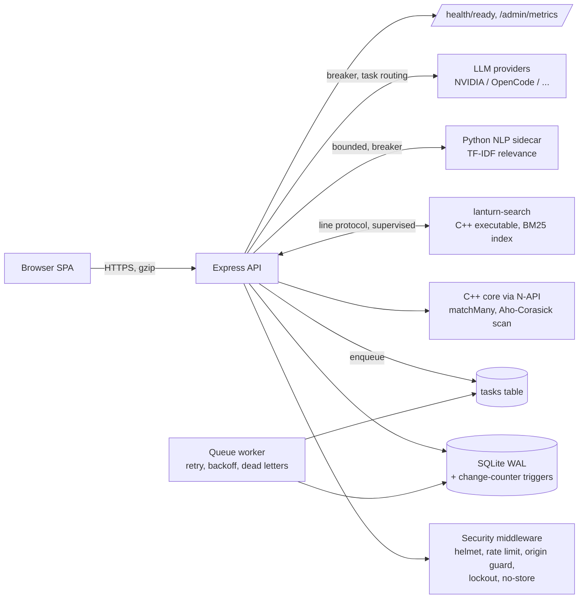
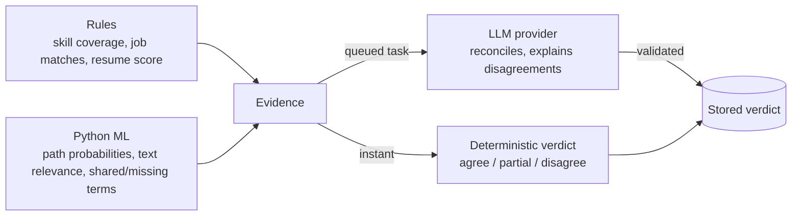

# LanTURN architecture

## Layers
1. **Client** — vanilla ES-module SPA (`public/`), hash router, XSS-safe `h()` DOM helper, strict CSP (no inline script/style).
2. **API** — Express (`src/app.js`, `src/routes/*`): helmet, rate limits, zod validation, JWT auth + RBAC, error envelope `{error:{code,message,details,requestId}}`.
3. **AI services** — `src/ai/*`: skill extraction, deterministic scoring, skill gap, job match, roadmaps; optional Anthropic adapter with schema validation and fallback to rules.
4. **Data** — SQLite (`node:sqlite`) + private file storage for resumes.

## Data flow
A. Client sends request (resume PDF, application). B. API authenticates, validates, routes. C. AI module analyses (rules first, LLM optional). D. Result stored and returned.

## Modules
Student (profile, jobs, applications, resume, career) · Employer (company, jobs, candidates, status pipeline) · AI guidance · Core backend (auth, admin approval).

## Security
Access JWT (15 min, memory) + rotating hashed refresh token in httpOnly cookie with reuse detection; employers PENDING until admin approval; ownership checks return 404; PDF magic-byte check, 4 MB cap, consent required; resume text treated as delimited data (prompt-injection guard).

## Scoring
Resume = 40 deterministic (sections 15, contact 5, length 10, quantified 10) + 60 rubric (clarity, skills, writing). Job match = 0.8 skill + 0.1 preference + 0.1 freshness.

## Design system
Tokens in `public/css/tokens.css` (void/obsidian black, black #050609, white, one ice blue #6EA8FF (palette E, Bleach mono); red reserved for errors; glass, gradients, glow). Components in `components.css`, layout/pages in `app.css`. Motion: drifting blue/violet aurora orbs, scanline, ticker, morphing liquid blobs, pointer-follow glass highlight; honours reduced motion/transparency.

---

## Platform hardening (v3.1)

### Design rules
1. **Everything optional degrades, nothing optional blocks.** The C++ core, the Python sidecar and each LLM provider are accelerators. If absent, slow or failing, the JS rules path answers. Each has a timeout, and a circuit breaker so a dead dependency costs nothing per request.
2. **Correct caches by construction.** SQLite triggers bump `data_versions` on any write to jobs, job skills, employer profiles or skills, so the open-jobs cache validates itself with one primary-key read, whoever wrote the data. The career map is memoised on a hash of its exact inputs.
3. **Slow work leaves the request path.** Posting a job returns immediately; match notifications to students run as a durable background task (`src/queue.js`) with retries, exponential backoff, dedupe keys, crash recovery and a dead-letter list (`/api/admin/tasks`).
4. **Same answer in every implementation.** The C++ kernels and their JS twins use integer round-half-up and are fuzz-tested for identical output (`test/native.test.js`).

### Security
Per-account lockout (5 failures / 15 min) and constant-time unknown-email path; weak-password policy; JWT pinned to HS256; same-origin guard on cookie endpoints; `Cache-Control: no-store` and Permissions-Policy on `/api`; server header and request timeouts; startup warnings for the default admin password and `SEED_DEMO`. An automated test enumerates every route and fails if any route outside a short public allowlist answers without a token.

### Operations
| Endpoint | Purpose |
|---|---|
| `GET /api/health/live` | process is up (never touches the database) |
| `GET /api/health/ready` | database, uploads dir, queue lag; 503 while draining. Used as the Railway healthcheck |
| `GET /api/admin/metrics` | per-route count, errors, avg/p50/p95; queue depth; breaker states; native/NLP status |
| `GET /api/admin/metrics.prom` | the same in Prometheus text format |
| `GET /api/admin/tasks`, `POST /api/admin/tasks/:id/retry` | inspect and retry background tasks |

SIGTERM (every Railway deploy) stops accepting traffic, lets in-flight requests and tasks finish, checkpoints the WAL, then exits; a 10 s watchdog guarantees it never hangs a deploy. Requests log one JSON line each with a request id.

### Measured performance
Synthetic data (3000 students, 400 jobs), 24 concurrent connections, 2 vCPU shared with the load generator, `node scripts/bench.mjs`:

| Endpoint | Before (req/s) | After (req/s) | After p95 |
|---|---|---|---|
| `GET /api/jobs/recommended` | 137 | 408 | 79 ms |
| `GET /api/career/map` | 102 | 502 | 65 ms |
| `GET /api/jobs` (page 1) | 508 | 785 | 47 ms |
| `GET /api/platform/stats` | 1594 | 4608 | 13 ms |

Native kernels, `node scripts/microbench.mjs`: `matchMany` over 100k students 7.1 ms JS vs 0.95 ms C++ (7.5x); skill scan of a 21 KB resume 4.4 ms vs 0.45 ms (9.8x). gzip costs about 20% throughput on loopback but shrinks JSON roughly 8x on a real network.

### Deploying the optional parts
- **C++ core:** built automatically by the Dockerfile's first stage. Locally: `npm run build:native`. Opt out with `DISABLE_NATIVE=1`. `/api/admin/metrics` shows `matchBackend`.
- **Python sidecar:** deploy `services/nlp` as a second Railway service (root directory `services/nlp`, uses its Dockerfile). On the web service set `NLP_SERVICE_URL` (the sidecar's private URL) and the same `NLP_SERVICE_TOKEN` on both. Without these, recommendations use skill match only.
- **Load testing:** `DISABLE_RATE_LIMIT=1` exists only for `scripts/bench.mjs`; never set it in production.

### lanturn-search (C++ executable)
A standalone full-text engine (`native/search/lanturn_search.cpp`, no dependencies): BM25 with field weights (title 3, company 2, skills 2, body 1), prefix matching on every query token, exact words beating prefixes, AND semantics. The Node server runs it as one long-lived child process (`src/searchEngine.js`): pipelined requests with ids, a timeout on each, restart after a crash, a circuit breaker, and a re-index whenever the jobs data version changes. A bad query or a crash cannot take the API down; any miss falls back to the SQL `LIKE` search. On 50k synthetic jobs it ranks a two-word query in about 5 ms versus 22 ms for an unranked `LIKE` scan (`npm run bench:native`). At today's few hundred jobs both are instant: the visible gain is relevance ordering and typeahead-style prefix matching. `/api/admin/metrics` reports its status under `search`.

### Persistent ML (Python sidecar)
`services/nlp/domain_model.py` trains a career-direction classifier (TF-IDF 1-2 grams + logistic regression over the 28 Career AIsle paths). There is no labeled resume dataset, so training is weakly supervised: synthetic resume-like documents are sampled from each path's topics, projects and descriptions (skills lists, sentences, noise from other paths). Be careful reading the held-out numbers in `/v1/model` (about 100% top-1): that hold-out comes from the same generator, so it checks the model learned the corpus, not real-world accuracy. Real resumes will score lower, which is why the result is shown as a second opinion next to the rule-based direction and never replaces it.

Persistence: models are versioned files (`domain-vN.joblib` + metadata) behind an atomically-swapped `CURRENT` pointer in `MODEL_DIR` (mount a Railway Volume at `/models`); a restart loads the saved model in milliseconds and retrains only if the corpus changed or the file is corrupt. The last 3 versions are kept. `POST /v1/train` (service token) persists extra labeled documents to `extra.jsonl`, retrains on corpus + every extra ever added, saves a new version and hot-swaps it. Admin: `GET /api/admin/ml` (status, versions) and `POST /api/admin/ml/retrain`. After changing `src/data/careerRoadmaps.js` run `node scripts/export-domains.mjs` (a test fails if the exported corpus is stale).

### Fusion: rules + ML + LLM concluding together (`src/ai/fusion.js`)

After a resume upload the student gets a deterministic verdict immediately (rules decide, ML corroborates or flags disagreement). If an AI provider is configured and the daily quota allows, a background task sends the whole evidence, including the ML output, to the provider, which concludes. The reply is schema-validated and may only pick a direction and jobs that appear in the evidence; anything else is rejected and the deterministic verdict stays (`llmSkipped` says why). The setup page shows the result with its sources ("rules + ML model + AI (nvidia)"); `POST /api/career/verdict` re-runs it. Unchanged evidence is not re-sent (hash), so it doesn't spend quota twice.
